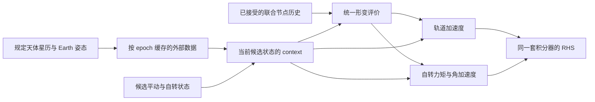

# 月球自转动力学开发约定与实施顺序

日期：2026-10-09。本文保存前几轮结构精简后的自转开发建议，结合当前
LunarOps 和本地 GROOPS、Tudat、PlanetaryEphemeris.jl 源码复核。
这是后续实现的设计约定，不表示地幔／流核自转已经实现。

## 当前起点

生产传播只积分 `[r_M/E, v_M/E]` 六维状态。Earth、太阳、行星、小天体
来自星历；Moon 的 PA 姿态也来自星历。相对加速度仍为
`a_M(model) - a_E(ephemeris)`，EIH 需要全体天体的牛顿辅助加速度和势。
不要在加入自转时改成地月联合平动或删减 EIH 辅助状态。

`inertia.py` 已计算延迟形变对应的归一化惯量和 degree-2 重力增量，
但它不是地幔／流核自转方程。其角速度由规定姿态的差分得到。
积分自转以后，惯量模型应直接读取当前及历史自转状态；参考星历只负责初值、
启动前历史和验证，不应覆盖积分状态。

已完成的结构约束继续沿用：

- YAML 展开后，每个 program schema 一次解析；构建冻结的 Problem，程序负责执行。
- 静态 registry 按物理类别选择模型；不增加兼容别名、旧参数转换、双接口、运行时兜底。
- 物理模型读取统一的 epoch/context；力与力矩分别返回加速度和力矩。
- serial/MPI 只替换执行后端；LLR 求解、参数估计和输出的科学计算保持共用。
- Cython 只承接固定形状数值内核，Python 负责装配；不增加通用 dispatcher。
- 时间尺度、尺寸、单位、坐标系、收敛和文件格式约束继续保留。

## 三个参考项目中真正值得沿用的设计

| 本地参考 | 可复用的设计 | LunarOps 的取舍 |
|---|---|---|
| [PlanetaryEphemeris.jl Problem](../../PlanetaryEphemeris.jl/src/abstractproblem.jl) | dynamics、tspan、initcond、params 聚合成一次传播问题 | 沿用冻结运行问题，不搬入完整行星联合积分体系 |
| [PlanetaryEphemeris.jl DE430 RHS](../../PlanetaryEphemeris.jl/src/DE430/dynamicalmodel.jl) | 地幔 Euler 方程、变惯量导数、地核角动量、核幔作用力矩及延迟响应一起计算 | 作为 DE430 物理公式与逐项数值基线；不要照搬几千行单体 RHS |
| [Tudat 自转状态导数](../../tudatpy/include/tudat/astro/propagators/rotationalMotionStateDerivative.h) | 姿态运动学、惯量、角速度导数、力矩模型分开 | 固定一种姿态表示和 Moon 单目标；不复制任意 N 天体与多姿态表示的通用层 |
| [GROOPS MoonRotation](../../groops-main/source/classes/earthRotation/moonRotation.h) | 向观测端提供 PA/ME 到惯性系的旋转服务 | 观测端消费姿态矩阵，不感知内部传播细节；不继承缺少星历时的近似模型分支 |

参考源码的单位和矩阵方向不同，不能直接把数组或常数塞进 LunarOps。
尤其 PlanetaryEphemeris.jl 中 Moon 的旋转矩阵在这些方程内用于惯性到地幔，
而 LunarOps 的 `moon_fixed2inertial_matrix` 是 PA 到 LCRS。

## 首先固定状态和物理约定

推荐固定 Hamilton、标量在前的单位四元数 `q=(q0,q1,q2,q3)`，
表示地幔 PA 到惯性 LCRS 的主动旋转 `R(q)`；地幔角速度 `omega_m`
以地幔 PA 分量表示。时间为 TDB 秒，位置 m，角速度 rad/s。
必须用一个简单的绕 z 轴正转测试固定乘法顺序和符号：

```text
R_dot = R [omega_m]_cross
q_dot = 0.5 * q ⊗ (0, omega_m)
```

四元数归一化是数值方案的一部分，不能在任意 RHS 阶段偷偷修改输入状态。
先记录范数漂移；若在接受节点做投影，需要同步检查 ABM 导数历史的一致性。
输出插值和延迟插值要保持相邻四元数同号，输出姿态再单位化，避免把 q 与 -q
之间的直线插值当成物理姿态。主传播初版只支持这一种姿态表示。

地核第一版采用轴对称、以地幔坐标表达的模型时，可保存核角速度
`omega_c_in_mantle`，而不另加核的 Euler 角。只有在核方向参与各向异性惯量、
形变或观测时，核姿态才是必要状态，届时应明确增加它。
不要因为参考代码有核 Euler 角就复制，也不要未经检查就删掉它们。

建议分阶段固定以下状态布局，不提前建立任意状态块注册框架：

| 阶段 | 状态 | 数值分量数 |
|---|---|---:|
| 刚体自转、规定平动 | `[q_m, omega_m]` | 7 |
| 轴对称地核、规定平动 | `[q_m, omega_m, omega_c_in_mantle]` | 10 |
| 平动＋上述自转 | `[r_M/E, v_M/E, q_m, omega_m, omega_c_in_mantle]` | 16 |

四元数有一个单位范数约束；表中是数值数组长度，不是独立物理自由度。
PA、ME、ICRF 轴和 LCRS 坐标变换必须在边界明确，不能用同名“fixed frame”混用。

## 惯量和力矩计算的边界

可以固定采用 `K=I/(M_M R_M²)` 和 `n=N/(M_M R_M²)`，这样 K 无量纲、
n 的单位为 s⁻²，并可复用现有归一化惯量。所有模型都使用同一个 Moon
质量与参考半径归一化；地幔和地核各自的惯量不能分别改用自身质量归一化。
现有全月静态惯量必须按模型参数拆分为地幔与核，不能把全月惯量同时用于两者。

地幔方程应包括变惯量项：

```text
K_m omega_m_dot = n_external + n_cmb
                  - omega_m × (K_m omega_m) - K_m_dot omega_m
```

`K_m_dot` 是在地幔坐标内惯量分量的时间导数。
初版可使用经收敛验证的差分基线；生产目标是同一次形变计算返回 K 与 K_dot。
求角加速度使用线性求解，不为每次 RHS 显式求逆。

规定的轴对称核惯量在地幔系内为常数时：

```text
K_c omega_c_dot = -n_cmb - omega_m × (K_c omega_c)
```

这里交叉项是 `omega_m`，因为核角速度分量是在旋转的地幔系中求导。
变核惯量模型还必须加入 `-K_c_dot omega_c`，不能继续套常量公式。
核幔内力矩在两套角动量方程中等大反向；压力耦合与黏性耗散分项输出。

作为与本地 DE430 RHS 对照的轴对称核起点，可固定如下符号：

```text
n_cmb = kappa * (omega_c - omega_m)
        + (K_c,zz - K_c,xx) * omega_c,z * (e_z × omega_c)
```

这是作用在地幔上的力矩；核方程使用负号。`kappa=k_nu/(M_M R_M²)` 的单位
为 s⁻¹。压力项与核扁率及旋转坐标中的输运项配套，不能只摘出一个公式。
关闭外力矩、固定惯量时，核幔力矩应保持惯性总角动量；黏性部分的能量变化应为
`-M_M R_M² * kappa * |omega_c-omega_m|²`，因此 `kappa>=0` 对应耗散。
DE440 或不同核模型的系数和假设需独立核对，不能只改模型名字沿用同一组参数。
上述常惯量、轴对称核公式已用 100 组随机角速度核对代数守恒与耗散符号，
归一化角动量导数残差最大约 7.72×10⁻²⁹ s⁻²，能量导数恒等式残差约
3.31×10⁻³⁶ s⁻³。这只是文档公式的自洽检查，实际积分模型仍须按后面的步骤验收。

第一项外力矩可以是 point-mass 对三轴 Moon 的重力梯度力矩：

```text
n_gravity = sum_j 3*GM_j/r_j³ * [u_j × (K_gravity u_j)]
```

`u_j` 为 Moon 指向 source 的单位向量，以 PA 表示。
刚体阶段 `K_gravity=K_m`。加入流核后，外部重力场的二阶矩一般由全月质量
分布决定，不能未经推导直接用拆分后的地幔惯量替换它。二阶重力系数、
惯量、核幔压力力矩的分配必须与选定的 DE 模型一致；同时明确球谐系数的
归一化约定，避免把 fully normalized 的 C20/C22 当成未归一化值。
这是基本二阶模型，不能据此宣称已经复现 DE430／DE440 的全部高阶 figure torque、
Earth figure 交互或相对论姿态项。后续按参考 RHS 逐项加入这些作用。

形变统一产生 `K、K_dot、degree2_coefficients`。同一个形变评价供轨道力与自转力矩
消费，避免静态二阶场重复叠加，也避免轨道和自转各维护一套 Love 数与延迟参数。
力与力矩接口可并列为 `acceleration(inputs)`、`torque(inputs)`，不要要求每个点质量力
都返回无意义的零力矩，或给每个力矩添加任意目标天体掩码。

## 与现有 epoch 缓存、延迟历史和积分器衔接

规定天体的轨道与 Earth 姿态属于 epoch data，可以继续批量预计算。
积分 Moon 姿态属于当前候选状态；ABM predictor/corrector 同一 epoch 的不同
候选状态会有不同的旋转矩阵，不能把它缓存在“只按时间键控”的 epoch 数据中。
现有规定姿态缓存和惯量 `_attitude_cache` 在耦合阶段必须相应调整。

建议的耦合评价路径如下；这是后续结构，不是当前已经具备的自转实现：



延迟状态从接受的平动／自转节点共同重建；启动前使用明确配置的种子历史。
保留负延迟导致的先进时刻外推及其诊断。不要把潮汐历史直接改回参考星历，
也不要对越界时刻 silently clamp 或返回最近节点。

当前 `LunarNodeBuffer`、`LunarDynamics`、Trajectory 和初值边界存在六维假设。
实际加入自转时再把数值积分器中的数组长度变为初值长度；历史和系统负责具体
状态布局。保留唯一 ABM 主算法及内部 DOP853 启动，不另复制一个“自转积分器”。
不要把 `MoonRelativeState` 本身扩展成任意平动／自转混合容器。

观测消费传播后姿态轨迹时提供明确的 `matrix(epoch)`、`matrices(epochs)`。
当前动力学的 `OrientationProvider` 已固定这两项；观测 frames 仍使用其明确的
`pa_to_lcrs_matrix()` 服务。新轨迹适配器在这里统一边界，不添加 callable/getattr
式探测，也不要忽略两套现有消费者的方向约定。

平动／自转联合传播接入 LLR 时，月心位置和姿态必须来自同一条轨迹。
复用现有地球星历＋月地相对状态的 Moon BCRS 重建，再提供积分姿态矩阵；
其他天体继续由选定星历提供。不能只替换姿态却让观测端仍使用旧星历月心。
INPOP 经度天平动修正属于对应的规定星历模型，不能不加区分地叠加到新的积分姿态。
GR 姿态／地球物理项同样要检查所选 LCRS 定义和 TDB 角速度约定，避免把参考 RHS
中的框架进动项与新坐标变换重复计算。

## 六步实施顺序和每步验收

1. **冻结本轮真实数据回归。** 保存输入哈希、配置、提交、轨道 RTN 差、
   MPI 预测和 O−C、反射器／偏差估计与正规方程。以这些结果作为后续平动和 LLR 基线。
2. **实现刚体姿态运动学。** 确定四元数约定、初始 PA 矩阵、角速度转换、
   状态布局与轨迹矩阵查询。先做规定平动下的无力矩球体／三轴刚体测试，
   检查惯性角动量与无耗散能量、四元数范数及方向符号。
3. **实现独立外力矩。** 先 Earth／Sun 二阶重力梯度，再高阶 figure 和
   Earth figure 交互；逐项与本地 DE430 RHS 比对，验证旋转协变性和力矩符号。
   初值和核心物理常数不能混用 DE430、DE440、INPOP。
4. **加入变惯量和核幔耦合。** 共用形变评价与延迟历史；验证 K_dot，
   关闭外力矩时的总角动量交换，以及黏性项导致的相对运动耗散。
   对相同输入逐项比较 PlanetaryEphemeris.jl 的 mantle/core 导数。
5. **接入平动／自转耦合 Problem。** 同一候选状态生成姿态、惯量、重力场、
   加速度和力矩；复用积分器和节点历史。先短弧，再阶梯扩展到月、年、十年，
   同 RHS 用 DOP853 交叉验证，检查步长和启动历史收敛。
6. **接入 LLR 与估计。** 预测和测距直接使用姿态轨迹；先验证固定轨迹的
   MPI／serial 一致性，再增加自转初值与物理参数的偏导和变分方程。
   先保留反射器＋测距偏差基线，再加入姿态参数，检查秩和参数相关性。

每步只增加其验收所需的结构。四元数误差用相对旋转角报告；角度很小时
避免仅使用 `acos(trace)` 丢失精度。除角度以外，还报告姿态误差对应的
`delta_R * r_reflector` 位移，便于判断其对 LLR 的量级。
姿态姿势正确并不自动证明角速度、力矩或延迟耗散正确，各项应独立验证。

## 本轮真实数据验证入口

配置、哈希和逐项比较保存在 `output/regression_20261009/`。
`scripts/run_regression_suite.py` 将参考提交 `e4f8caa` 与当前实现隔离运行，
六种 O−C 另以精简前的 `c6cd6f8` 复核，
还与既有十年轨道和预测／O−C 文件比较。旧格式读取只存在于该离线验证脚本，
不会重新引入生产兼容层。MPI 场景固定为 32 ranks，其中 rank 0 调度、31 workers。

```bash
.venv/bin/python -m scripts.run_regression_suite prepare
sbatch run_regression_orbit.sbatch
sbatch run_regression_mpi.sbatch
sbatch run_regression_early.sbatch
.venv/bin/python -m scripts.run_regression_suite compare
```

最终数值和作业状态记录在 [本轮回归报告](REGRESSION_20261009.md) 中。源码等价、历史结果复现、
相对参考星历的误差是三个不同的证据；不能把当前受迫模型与参考星历存在的小误差
解释为已经完成全套星历物理模型。
