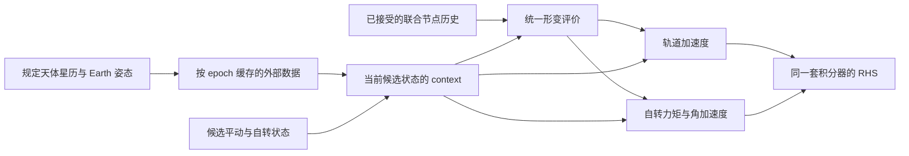

# 月球自转动力学开发约定与实施顺序

日期：2026-10-09。本文保存前几轮结构精简后的自转开发建议，结合 DE430／DE440
论文、当前 LunarOps 和本地 GROOPS、Tudat、PlanetaryEphemeris.jl 源码复核。
2026-10-10 已实现常惯量及正延迟形变的平动／地幔／流核联合传播。
按本轮开发边界，**第六步暂不实施**：没有接入 LLR，也没有增加参数估计或变分方程。

2026-10-11 的 [Chat review 实证核对](DE440_CHAT_REVIEW_VERIFICATION.md)
记录了 Earth tide 相对／绝对边界和 ABM 导数历史修复，以及仍需解决的
KBO ring、GMSDOT、负时滞未来预测和 C21/S21 轴系约定。后续自转开发
必须维持规定地球的绝对加速度一致性；Pavlov 2016 的常数偏置形式可用于
核对二阶场，但不能直接据它认定 DE440 注释偏置的正式定义。

2026-10-12 的 [KBO 环与 GMSDOT 验证](DE440_MISSING_MODELS_VALIDATION.md)
已完成四组十年对照；两项开启时月地相对位置最大差为 2.81 cm，姿态主差异仍在。
后续 [姿态专项 review 核对](DE440_ROTATION_CHAT_REVIEW_VERIFICATION.md)
单独验证 C21/S21 的符号、归一化、引力场偏置和机械惯量方案，并保存 PA／ICRF
两种坐标下的残差诊断。随后按用户确认，
[Pavlov 式 (16) 正式修复](DE440_PAVLOV_EQ16_FIX.md) 已将静态 C21/S21/S22
偏置接入积分姿态与规定姿态的共同二阶场公式；机械惯量与初值不变。

[地球引力极轴 ERFA 验证](EARTH_GRAVITY_ORIENTATION_ERFA_VALIDATION.md)
已用独立论文极轴表达式核对 6804 个历元，将 DE430／DE440 的标准岁差、
平黄赤交角和旋转矩阵改为 ERFA，保留 JPL 的单项章动与拟合偏置。
DE430 另修正了与 Folkner 原文不符的章动系数，传播影响独立记录。

[DE440 与 IAU 2006/2000A 极轴对照](DE440_IAU2006_EARTH_POLE_EXPERIMENT.md)
已完成 1969–2030 年极轴、固定状态加速度／力矩及两次十年联合积分。
IAU 极轴使轨道最大残差由 28.46 mm 增至 64.91 mm，姿态最大残差仅由
39.087 mm 降至 39.033 mm；保留 DE440 默认极轴，IAU 仅作为可配置实验选项。

本地 PlanetaryEphemeris.jl 原生 DE430 的分项与三天联合轨迹对照见
[DE430_ROTATION_COMPARISON.md](DE430_ROTATION_COMPARISON.md)，其中分别记录
形变参考角速度、Earth figure 惯量／纬度约定及延迟历史算法差异。

## 延迟形变与联合传播实现状态（2026-10-10）

第四、第五步的主体已经接入现有 `LunarOrbitPropagation`，保留下面的常惯量算例作为
独立基线。新增 [deformation.py](../lunarops/classes/dynamics/deformation.py) 对同一延迟
epoch 的平动、姿态、地幔角速度和历史导数求形变，返回 `K_T、K_m_dot` 与分项；
`K_m=K_T-K_c`，流核惯量保持常量。地幔方程包含 `-K_m_dot @ omega_m`。
轨道力与外部 figure 力矩消费同一个 Moon `GravityField`，直接替换动态 degree-2 系数，
保留 degree 3–6；不叠加第二份静态二阶场。Earth figure 和 quadrupole 力矩同样读取
该次评价的 `K_T`。每个候选状态重建姿态并清理 figure 缓存。

[history.py](../lunarops/classes/dynamics/history.py) 在现有 `LunarNodeBuffer` 中保存完整
联合状态与接受节点导数；状态和导数查询来自同一个 Hermite 多项式。13 阶历史使用
7 个节点，按请求 epoch 选择局部模板，允许查询早于最近窗口的接受历史。
规定天体仍只保存六维状态。外部历史先选局部模板再取天体，避免长弧反复复制完整数组。

延迟系统采用**正向 method of steps**。配置必须明确声明
`lunarRotation.deformation.seedModel: rigidBackward` 和 `seedDurationSeconds`：
用常惯量联合方程短回推建立种子，随后正向 DOP853 启动，再进入现有 ABM corrector。
这不是反向求解延迟方程，也不是从参考 BPC 自动补齐历史。
种子与正向解使用各自插值模板，避免把初始导数的跳变跨弧拟合。
当前只实现正 `delayDays`，要求 `stepSeconds <= delayDays*86400`，
种子弧至少覆盖延迟加历史模板跨度，并与固定步长网格对齐。
零延迟的隐式 spin 方程、步长大于延迟时的临时候选连续段尚未实现。

Moon 形变的状态／导数查询必须位于接受或种子弧内，越界直接报错。
Earth 潮汐原有负延迟仍明确外推平动；元数据记录先进查询次数和最大外推秒数。
输出自转表增加全月惯量、地幔惯量和惯量导数各六个独立分量，以及已有分项力矩、
地幔／核角加速度与四元数范数漂移。没有在 RHS 中投影四元数。

可运行的 [DE430 延迟形变算例](../configs/lunarops_orbit_rotation_deformed_de430.yml)
采用 DE430 的 `k2=0.024059、tau=0.09583054727330669 day`，其余初值／源列表与
常惯量算例一致。种子弧为一天；仍省略小天体，不能标记为完整 DE430 复现。

```bash
.venv/bin/python -m lunarops run configs/lunarops_orbit_rotation_deformed_de430.yml --working-dir .
sbatch run_rotation_validation.sbatch
.venv/bin/python -m scripts.run_rotation_validation compare
.venv/bin/python -m scripts.run_rotation_validation reference
```

[验证脚本](../scripts/run_rotation_validation.py) 和
[Slurm 脚本](../run_rotation_validation.sbatch) 包含三天／月／年／十年弧与半步长对照，
并分别改变启动步长、历史阶数和种子长度。每个任务使用一个 CPU，不启动 MPI。
实际输出位于 `output/rotation_validation_20261010`，数值汇总为 `validation.json`。

Slurm 作业组 `44961853` 的 11 个任务均已完成、退出码为零。下面是统一每日输出
网格上的步长对照；短弧另有启动步长、9／13 阶历史和一天／两天种子覆盖对照。
种子长度对照只检验覆盖长度，不证明刚体种子已等于拟合的非弹性历史。

| 传播弧 | 对照步长（秒） | 姿态最大差（rad） | 地幔角速度最大差（rad/s） | 月地相对位置最大差 |
|---|---|---:|---:|---:|
| 三天 | 1800／900 | 1.56e-15 | 1.36e-21 | 7.63 µm |
| 30 天 | 5400／2700 | 1.88e-14 | 1.73e-20 | 2.01 mm |
| 365 天 | 5400／2700 | 2.66e-13 | 1.60e-19 | 9.63 mm |
| 3650 天 | 5400／2700 | 5.25e-12 | 7.94e-19 | 28.38 mm |

十年四元数范数最大漂移 `3.18e-14`；惯量导数零迹残差小于 `1.1e-28 s⁻¹`。
十年姿态相对 DE430 BPC 的最大差约 `8.85e-9 rad`，对应月面位移尺度约 `15.38 mm`；
同时月地相对轨道的参考 RTN 最大差约 `[38.5, 80.8, 0.90] m`。
参考差反映开发模型与 JPL 解的物理／初值差，不能与步长差混为一谈。
本算例的十年平动步长差仍为厘米量级，这不构成未来毫米级 LLR 误差预算已经通过的证据。
月弧另验证了局部外部历史模板优化，轨道、自转和加速度数值数组均逐值相同。

独立测试包括形变解析导数与差分、张量对称／零迹、形变开关、变惯量角动量链式法则、
动态重力场共用与候选缓存失效、历史模板选择、显式种子和步长收敛。
另用 SciPy 自适应 DOP853 的独立 method of steps，直接微分其 dense polynomial，
与同一延迟 RHS 的 ABM 对照；不复用 LunarOps 的历史插值核。
全套测试 **378 passed**。原 DE430／DE440 各一天六维轨道与加速度诊断重新运行后，
仍与实现前 HEAD 输出**逐值相同**；记录在 `prescribed_regression/comparison.json`。

对本地 Julia 的固定输入核，脚本提取并实际执行 `ITM1、ITM2` 及 mantle/core 方程，
共同使用 SI 秒和全月 `M R²` 归一化。100 组随机输入的形变张量最大差约
`6.6e-23`，惯量导数差约 `1.4e-21 s⁻¹`，地幔／核角加速度差约
`4.1e-27`／`3.2e-27 rad/s²`；原始源码哈希和比较结果保存于
`julia_reference/comparison.json`。这只核对固定输入的物理核，不声称与完整 Julia
星历传播相同；其 Earth figure 采用地幔惯量而本文使用全月惯量的差异仍独立记录。

## 第一批常惯量基线记录（2026-10-10）

现有 `LunarOrbitPropagation` 已可选择同时积分平动、地幔四元数／角速度和流核角速度，
状态长度为 13 或 16。未配置 `lunarRotation` 时仍执行原有六维轨道模型。

- [rotation.py](../lunarops/classes/dynamics/rotation.py)：Hamilton 运动学、DE Euler 初值转换、
  常惯量地幔／轴对称核方程、黏性与压力耦合、DE440 测地进动。
- [torques.py](../lunarops/classes/dynamics/torques.py)：二阶惯量基线、完整配置球谐场的
  各源 figure 力矩、Earth J2／Moon figure 交互。核幔内力矩保持独立诊断。
- `DynamicsEvaluationContext` 取代旧 force context；候选 Moon 姿态不写入 epoch 缓存。
  轨道力与力矩共用每个源的球谐场评价，corrector 更换候选状态时清理缓存。
- 现有 ABM／DOP853 推进联合状态；接受的旋转导数重新在最终 corrector 状态评价，
  不投影四元数、不修改积分输入。联合历史重建 Moon 位置时只取前六个平动分量。
- `LunarTrajectory.orientation_state()`／`matrix()`／`matrices()` 提供同源姿态和角速度；
  `LunarPropagationProblem` 保存只读联合初值。新增 `LunarRotationFile` 输出状态、
  范数漂移、各源／核幔力矩、进动率和角加速度。

本批采用**常惯量**，不包括延迟非弹性形变、K_dot 历史导数、LLR 轨迹装配和自转参数
变分方程。积分自转与现有规定姿态的 `lunarDegree2Gravity` 同时配置会直接报错，
不会静默继续使用参考姿态。核幔压力力矩统一使用液核自旋 `omega_c,z`（DE430 与 DE440 相同），不再提供 `pressureSpin` 选项（2026-10-22）。

可运行的 [DE430 常惯量算例](../configs/lunarops_orbit_rotation_rigid_de430.yml)
使用表 7 的初始 epoch／姿态／地幔与核角速度、表 11 的核参数，月球场到 degree/order 6。
所选外部轨道是 major bodies，包含 Earth 潮汐，省略小天体和月球延迟形变；
因此该算例是自转开发基线，不是完整 DE430 的复现。

```bash
.venv/bin/python -m lunarops run configs/lunarops_orbit_rotation_rigid_de430.yml --working-dir .
.venv/bin/python -m lunarops run configs/lunarops_orbit_rotation_rigid_de430.yml --working-dir . \
  --set stepSeconds=900 --set startupStepSeconds=112.5 \
  --set outputDir=./output/rotation_rigid_de430_half_step
```

三天实测：1800／900 秒步长的姿态最大差 `1.82e-15 rad`，
地幔／核角速度最大差分别为 `4.66e-21`／`3.81e-21 rad/s`；
四元数范数漂移 `6.66e-16`，平动位置最大差约 `0.562 mm`。
初始姿态与 DE430 BPC 相差 `1.31e-16 rad`；三天相对参考姿态最大差
`1.66e-8 rad`，月面位移尺度约 `2.88 cm`。后者是模型／初值传播差，
不能与步长收敛证据混为一谈。数值记录在 `output/rotation_rigid_de430/validation.json`。

独立测试覆盖：DE Euler 运动学与矩阵导数；二阶球谐反作用力矩与势能符号；
核幔角动量交换与 DE430 黏性耗散；进动仅加入一次；Earth figure 旋转协变；
候选状态缓存失效；无外力刚体／核模型正反向 ABM 与独立 DOP853 对照；
配置、真实 ICGEM 读取及联合状态／分项诊断输出。
全套测试 **367 passed**；本轮 DE430／DE440 各一天的原六维轨道和加速度诊断，
与实现前 HEAD 隔离运行的数值数组**逐值相同**，最大差为零。
比较记录在 `output/rotation_rigid_de430/regression_prescribed/comparison.json`。

上述延迟评价及联合历史已经完成。本轮暂不接入轨迹到 LLR 的星历／姿态装配和
自转参数估计；常惯量基线只用于物理／数值对照。

## 物理依据与模型范围

两篇本地论文是方程依据，三个项目是实现参考。下面的页码均为 PDF 页码，
与论文印刷页码一致；源码与论文存在差异时，应记录差异，不能以源码自动覆盖论文。

| 资料 | 本文使用的位置 |
|---|---|
| [Folkner 等，The Planetary and Lunar Ephemerides DE430 and DE431，IPN Progress Report 42-196，2014](<../../document/Folkner 等 - The Planetary and Lunar Ephemerides DE430 and DE431.pdf>) | §II.E，pp.8–10，式 (10)–(20)：PA 姿态、角速度和 MER 变换；§IV，pp.15–18，式 (33)–(45)：地幔／核动力学、惯量、力矩；p.49 表 7 和 p.51 表 11：初值与参数 |
| [Park 等，The JPL Planetary and Lunar Ephemerides DE440 and DE441，AJ 161:105，2021，DOI 10.3847/1538-3881/abd414](<../../document/Park 等 - 2021 - The JPL Planetary and Lunar Ephemerides DE440 and DE441.pdf>) | §2.4，p.4，式 (8)–(19)：姿态与框架；§3.2，pp.5–6，式 (28)–(34)：figure 场与动态二阶系数；§4，pp.7–10，式 (42)–(58)：自转、测地进动、形变和核幔力矩 |

论文中的物理约束不意味着要复制其软件结构。开发期仍直接修改内部接口，
不增加旧配置兼容、备用姿态源、自动猜测核参数或通用多刚体框架。

### DE430／DE440 与长时段版本的区别

| 项目 | DE430／DE431 | DE440／DE441 | 对 LunarOps 的要求 |
|---|---|---|---|
| 地幔和流核 | 非弹性地幔、固定在地幔坐标中的轴对称核边界 | 同一基本结构 | 核角速度用地幔分量；核边界形状不由核 Euler 角决定 |
| 输运交叉项 | 式 (34)、(35) 使用 `omega_m` | 式 (43)、(45) 使用 `omega_m - nu_gp` | DE440 必须包含式 (44) 的测地进动；姿态运动学仍按式 (12)–(14) |
| Moon figure 对点质量的作用对象 | Earth、Sun、Mercury、Venus、Mars、Jupiter | 增加 Saturn | Earth／Sun 二阶模型只是首阶段；模型完整性按实际源列表及 degree/order 记录 |
| PA 的确定 | 文中以 LLR 分析确定，惯性框架为 ICRF2 | 采用 GRAIL 分析的 PA，惯性框架为 ICRF3 | 初值、球谐场、反射器坐标和 PA→MER 常数必须同源 |
| 长时段版本 | DE431 关闭核幔黏性阻尼 | DE441 关闭核幔黏性阻尼 | 仅令黏性参数为零；仍保留流核、核扁率、压力耦合和地幔形变耗散 |

DE430／DE440 保留 LLR 可观测的核幔阻尼；向过去积分时误差会增长，
因此 DE431／DE441 为长时段需求关闭这项阻尼。不能据此在现代 LLR 模型中
默认关闭耗散，也不能用反向长弧中的自由核模态增长直接判定积分器错误。
各版本还使用各自拟合的参数和初值；只把 DE440 的黏性参数清零并不会复现 DE441 文件。

推荐先建立可逐项核对的 DE430 物理基线，再补齐 DE440 差异以服务现有 DE440／LLR
配置。共用运动学、惯量和力矩计算核；用明确的物理参数和模型组成区分实验，
不建立两套传播程序，也不把 `model: de440` 作为“所有物理已经实现”的标签。

## 当前起点

原有基线配置积分 `[r_M/E, v_M/E]` 六维状态。Earth、太阳、行星、小天体
来自星历；Moon 的 PA 姿态也来自星历。相对加速度仍为
`a_M(model) - a_E(ephemeris)`，EIH 需要全体天体的牛顿辅助加速度和势。
不要在加入自转时改成地月联合平动或删减 EIH 辅助状态。

联合积分的正式 DE430 长弧验证必须保持原轨道基线的
`externalBodyGroups: [de430_major, de430_asteroid]`。早期常惯量／形变开发配置的
major-only 环境只适合明确限定模型的实验。由于相对加速度使用完整参考历表的
Earth 加速度，删掉 Moon 一侧的小行星引力不会通过相对坐标自动抵消。
不能把这种外部环境变化造成的轨道差归因于自转耦合。
十年对照的配置、分项加速度和轨迹输出归档于
`output/rotation_orbit_audit_20261010`；正式联合积分配置为
[lunarops_orbit_rotation_de430_10a.yml](../configs/lunarops_orbit_rotation_de430_10a.yml)。

`inertia.py` 已计算延迟形变对应的归一化惯量和 degree-2 重力增量，
但它不是地幔／流核自转方程。其角速度由规定姿态的差分得到。
积分自转以后，惯量模型应直接读取当前及历史自转状态；参考星历只负责初值、
启动前历史和验证，不应覆盖积分状态。

已完成的结构约束继续沿用：

- YAML 展开后，每个 program schema 一次解析；构建冻结的 Problem，程序负责执行。
- 静态 registry 按物理类别选择模型；不增加兼容别名、旧参数转换、双接口、运行时兜底。
- 物理模型读取统一的 epoch/context；力与力矩分别返回加速度和力矩。
- serial/MPI 只替换执行后端；LLR 求解、参数估计和输出的科学计算保持共用。
- Cython 只承接固定形状数值内核，Python 负责装配；不增加通用 dispatcher。
- 时间尺度、尺寸、单位、坐标系、收敛和文件格式约束继续保留。

## 三个参考项目中真正值得沿用的设计

| 本地参考 | 可复用的设计 | LunarOps 的取舍 |
|---|---|---|
| [PlanetaryEphemeris.jl Problem](../../PlanetaryEphemeris.jl/src/abstractproblem.jl) | dynamics、tspan、initcond、params 聚合成一次传播问题 | 沿用冻结运行问题，不搬入完整行星联合积分体系 |
| [PlanetaryEphemeris.jl DE430 RHS](../../PlanetaryEphemeris.jl/src/DE430/dynamicalmodel.jl) | 地幔 Euler 方程、变惯量导数、地核角动量、核幔作用力矩及延迟响应一起计算 | 用于相同输入的分项对照；区分完整 `DE430!` 与无形变短回推函数，不作为未经核验的 JPL 实现 |
| [Tudat 自转状态导数](../../tudatpy/include/tudat/astro/propagators/rotationalMotionStateDerivative.h) | 姿态运动学、惯量、角速度导数、力矩模型分开 | 固定一种姿态表示和 Moon 单目标；不复制任意 N 天体与多姿态表示的通用层 |
| [Tudat 二阶引力力矩](../../tudatpy/include/tudat/astro/gravitation/secondDegreeGravitationalTorque.h) | 用同框架的相对位置和惯量张量直接计算二阶力矩 | 作为刚体二阶测试参考；该类明确省略高阶项，不能代表完整 DE figure torque |
| [GROOPS MoonRotation](../../groops-main/source/classes/earthRotation/moonRotation.h) | 向观测端提供 PA/ME 到惯性系的旋转服务 | 观测端消费姿态矩阵，不感知内部传播细节；不继承缺少星历时的近似模型分支 |

参考源码的单位和矩阵方向不同，不能直接把数组或常数塞进 LunarOps。
尤其 PlanetaryEphemeris.jl 中 Moon 的旋转矩阵在这些方程内用于惯性到地幔，
而 LunarOps 的 `moon_fixed2inertial_matrix` 是 PA 到 LCRS。

## 前期七项架构建议的保留与修订

这些建议对后续自转有直接参考价值。以下明确职责及当前实现的对应关系，
作为开发约定；其中常惯量／延迟形变与联合传播已按首节实现，LLR 接入暂不实施。

### 1. 把自转积分状态与姿态查询服务分开

Tudat 将自转传播设置、状态导数、力矩构建和积分结果的旋转星历分开：
[propagationSettings.h](../../tudatpy/include/tudat/simulation/propagation_setup/propagationSettings.h)、
[rotationalMotionStateDerivative.h](../../tudatpy/include/tudat/astro/propagators/rotationalMotionStateDerivative.h)、
[createTorqueModel.h](../../tudatpy/include/tudat/simulation/propagation_setup/createTorqueModel.h)、
[setNumericallyIntegratedStates.h](../../tudatpy/include/tudat/simulation/propagation_setup/setNumericallyIntegratedStates.h)。

LunarOps 可以采用如下职责划分：

| 对象 | 职责 |
|---|---|
| `LunarRotationState` | 当前四元数、地幔角速度；加入轴对称核后增加核角速度 |
| `LunarTorqueModel`／`LunarTorqueGroup` | 各项力矩及其合成、分项诊断 |
| `LunarRotationDynamics` | 姿态运动学和地幔／核角速度导数 |
| 现有积分器与联合历史 | 推进状态、保存接受节点、提供延迟状态 |
| 轨迹的 `LunarOrientationProvider` | 将已传播状态转换成其他模型可查询的姿态及角速度 |

历史对象是联合节点的视图；如果需要名为 `LunarRotationHistory` 的服务，
它不另存一份自转节点。RHS 使用当前候选状态，不能通过已完成轨迹的 provider
查询一个尚未接受的候选姿态。

当前 [LunarDegree2GravityModel](../lunarops/classes/dynamics/inertia.py) 计算规定轨道／
姿态下的延迟惯量及二阶重力增量，还在内部差分角速度。后续应让它消费统一的
姿态／角速度及延迟状态，负责形变和重力系数；静态物理参数继续是独立数据。
姿态推进属于自转动力学，姿态查询属于 provider，不向该重力模型继续添加这些职责。

### 2. 统一姿态矩阵和角速度的物理来源

[GROOPS EarthRotation](../../groops-main/source/classes/earthRotation/earthRotation.h)
的 `rotaryMatrix(time)` 和 `rotaryAxis(time)` 来自同一旋转服务；
[planetOrbit.cpp](../../groops-main/source/programs/orbit/planetOrbit.cpp) 同时查询它们。
其中矩阵方向是 CRF → TRF，角速度在 CRF 表示，时间参数为 GPS。
借鉴的是同源查询设计，LunarOps 保持 PA → LCRS、TDB 秒的约定。

建议新服务固定以下概念接口：

```text
LunarOrientationState
    pa_to_lcrs
    angular_velocity_pa_rad_s
    angular_velocity_lcrs_rad_s = pa_to_lcrs @ angular_velocity_pa_rad_s

orientation_state(epoch) -> LunarOrientationState
orientation_states(epochs) -> batch
```

只保存一份角速度，LCRS 分量从 PA 分量派生；核角速度属于动力学状态，
不塞入所有观测消费者都要接收的姿态结果。矩阵与地幔角速度必须来自同一状态和同一
epoch。规定姿态阶段可由 provider 封装矩阵差分；积分阶段直接使用积分角速度。
缓存单次评价的姿态结果，避免力、形变、力矩分别差分或各建一套缓存。

现有 `matrix(epoch)`／`matrices(epochs)` 可作为同一服务的矩阵访问入口；
frames 的 `pa_to_lcrs_matrix()` 在明确边界适配。它们不代表允许多种可探测接口，
不增加 callable／getattr 兜底。后续接入时直接修改内部消费者即可。

### 3. 轨道力和自转力矩共用评价上下文

[GROOPS Forces](../../groops-main/source/classes/forces/forces.h) 把时间、位置、速度、
body／Earth 旋转和星历作为共同环境传入。LunarOps 已有
[DynamicsEpochData／DynamicsEvaluationContext](../lunarops/classes/dynamics/context.py)，
应沿用该边界；接入本批自转时已将旧 force context 直接改名为 `DynamicsEvaluationContext`，
不保留一套旧名兼容层，也不再套 RotationContext／OrientationContext／TorqueContext。

```text
DynamicsEpochData
    TDB epoch
    规定天体的位置、速度与 Earth 姿态
    星历 Earth 加速度、点质量辅助数据

DynamicsEvaluationContext
    当前候选平动／自转状态
    同一候选状态派生的 Moon 姿态、角速度
    DynamicsEpochData、接受节点历史
    本次形变、力和力矩共用的计算缓存
```

前期“把所有 Moon 姿态及角速度放进 DynamicsEpochData”的建议只适用于规定姿态。
自转耦合后应按上面的布局移到候选状态 context；同一时刻的不同 corrector 状态
不能共用姿态、惯量或重力修正。每次候选状态更新都需清理对应计算缓存。
接口保持 `acceleration(inputs)` 和 `torque(inputs)`；按本文归一化约定，
`torque` 返回 PA 分量的 `n=N/(M_M R_M²)`，单位 s⁻²，不能混入 N·m。

### 4. 简化 Tudat 的 torque map，保留分项力矩

Tudat 的 `SelectedTorqueMap` 按目标天体 → 源天体 → 模型列表组织。
Moon 单目标可固定为 `LunarTorqueGroup([EarthGravityTorque, SunGravityTorque, ...])`，
源天体和物理参数在构造时固定，模型从统一 context 读取状态。
无需多目标掩码、任意刚体注册或多层动态 dispatcher。
核幔耦合需保留地幔／核等大反向的内部力矩，与外力矩分别诊断；
不能将其当作一个只作用于全月的普通外力矩求和。
仅在明确的物理需求出现时添加其他天体或 external torque。

### 5. 在已有 Problem 上扩展联合传播

PlanetaryEphemeris.jl 的 Problem 聚合 dynamics、tspan、initcond、params。
前期“lunar_orbit_propagation 仍负责全部装配”的描述已经过时：当前已有冻结的
[LunarPropagationProblem／build_lunar_propagation_problem](../lunarops/programs/lunar_orbit.py)。
本批已把原轨道 Problem 扩展为 `LunarPropagationProblem`：
系统、初始 epoch／终止 epoch、联合初值、积分器设置及输出路径。
force group、torque group 和形变模型由 system 持有，不在 Problem 中重复保存。

入口构建 problem，再执行传播和序列化；轨道和自转导数组件由同一系统组合，
输出一条联合轨迹。冻结对象中的初值数组也应只读，不能只依赖 dataclass 的 frozen。
不另建轨道 Problem、自转 Problem、耦合 Problem 三层转存相同字段。

### 6. 共用历史生命周期，保留不同量的数值规则

[PlanetaryEphemeris.jl propagation.jl](../../PlanetaryEphemeris.jl/src/propagation.jl)
把 Taylor 多项式解作为连续星历，并预计算辅助加速度和势；这不是把任意原始星历
重新采样后自动得到同等精度的通用方案。
其 `DE430!` 每次用 `NBP_pN_A_J23E_J23M_J2S_threads!` 做短时 Taylor 回推，
后者固定未形变地幔惯量，用于生成延迟状态；这与 LunarOps 查询联合积分历史
并不是同一个数值方案。比较时先固定相同延迟输入和导数，再比较物理项，
最后独立评估两种延迟重建的误差，不把整个轨迹的差异全归因于力矩公式。
LunarOps 继续采用批量 epoch 预计算、`DelayedHistory`、`LunarNodeBuffer`、
`_StepHistoryCache`，在接受节点中共同保存平动／自转及必要的规定天体状态。

复用时间网格、节点存储、延迟查询和每步缓存生命周期；平动、多项式外部星历、
四元数仍需明确的数值处理。四元数的符号连续和归一化按下文约定，
不把普通位置插值原样当成 SO(3) 插值。外部 BSP／BPC 继续由现有星历查询服务
负责；只有经精度验证后才用额外插值替代它。不要分别维护三套节点和失效策略，
也不要为了统一而把姿态、轨道、星历强行用同一种插值公式处理。

### 7. 暂不搬入通用软件框架

当前不引入多姿态参数化、多刚体／多中心 torque map、多弧、质量状态、
通用环境更新器、完整插件系统，或 Taylor 自动微分积分框架。
变分方程在自转参数进入 LLR 估计时有实际价值，按第六步再实现，
不能把“现在不引入”误读为后续不需要。
先以固定 Moon 状态布局、力／力矩组、单一联合 context、现有 Problem 和历史机制
完成可验证的物理模型，再按实际需求增补结构。

## 首先固定状态和物理约定

推荐固定 Hamilton、标量在前的单位四元数 `q=(q0,q1,q2,q3)`，
表示地幔 PA 到所选惯性轴的主动旋转 `R(q)`；地幔角速度 `omega_m`
以地幔 PA 分量表示。时间为 TDB 秒，位置 m，角速度 rad/s。
对照 DE 方程时采用对应 ICRF 轴；当前 LunarOps 的 PA→LCRS 服务将这套
姿态矩阵用于其 LCRS 轴，需明确这是怎样的轴约定。相对论空间坐标变换与轴旋转
是不同操作，不能因为 provider 名字含 LCRS，就认为测地进动已经计算。
必须用一个简单的绕 z 轴正转测试固定乘法顺序和符号：

```text
R_dot = R [omega_m]_cross
q_dot = 0.5 * q ⊗ (0, omega_m)
```

四元数归一化是数值方案的一部分，不能在任意 RHS 阶段偷偷修改输入状态。
先记录范数漂移；若在接受节点做投影，需要同步检查 ABM 导数历史的一致性。
输出插值和延迟插值要保持相邻四元数同号，输出姿态再单位化，避免把 q 与 -q
之间的直线插值当成物理姿态。主传播初版只支持这一种姿态表示。

两篇论文都积分核 Euler 角，但其角速度 RHS 和核幔力矩不依赖这些角，
且核惯量固定在地幔系内。因此在本文的轴对称核模型下，只保存
`omega_c_in_mantle` 就能闭合地幔／核动力学，并提供地幔姿态给 LLR。
核 Euler 角在此模型中属于可后处理的诊断量；以后若改变核惯量／边界模型，
使其真正依赖核取向，再增加核姿态状态。删除的是不参与反馈的状态，不能删除核角速度。

建议分阶段固定以下状态布局，不提前建立任意状态块注册框架：

| 阶段 | 状态 | 数值分量数 |
|---|---|---:|
| 刚体自转、规定平动 | `[q_m, omega_m]` | 7 |
| 轴对称地核、规定平动 | `[q_m, omega_m, omega_c_in_mantle]` | 10 |
| 平动＋上述自转 | `[r_M/E, v_M/E, q_m, omega_m, omega_c_in_mantle]` | 16 |

四元数有一个单位范数约束；表中是数值数组长度，不是独立物理自由度。
PA、ME、ICRF 轴和 LCRS 坐标变换必须在边界明确，不能用同名“fixed frame”混用。

### 初值、单位和 PA／MER 配准

论文旋转矩阵是被动矩阵。DE430 式 (10)／DE440 式 (8) 给出
`R = Pz(-phi) Px(-theta) Pz(-psi)`；若使用主动基本旋转，则为
`R = Az(phi) Ax(theta) Az(psi)`。先与现有
[CalcephLunarOrientation](../lunarops/classes/ephemerides/lunar_orientation.py)
的矩阵逐时刻比对，再转成四元数，不直接复制 GROOPS 的乘法次序。

若星历查询返回的是 Euler 角及其导数，先按论文的运动学关系转换：

```text
omega_m,x = phi_dot*sin(theta)*sin(psi) + theta_dot*cos(psi)
omega_m,y = phi_dot*sin(theta)*cos(psi) - theta_dot*sin(psi)
omega_m,z = psi_dot + phi_dot*cos(theta)
```

Euler 角导数不是角速度分量。DE430 表 7 的角速度单位为 rad/day，
需除以 86400；角加速度、以 day 为单位的延迟和黏性速率也分别换算。
该表初始 epoch 是 JD(TDB) 2440400.5，不能把其角速度直接放到任意启动日期。
矩阵差分可作独立核对，不作为已经拥有角速度状态后的生产计算路径。

公开 libration 数据不能提供完整流核初值。使用 DE430 表 7，或与目标 DE
对应的原始积分常数和初始 epoch；在别的起点需要先传播这组核状态，或对 LLR
估计核初值并报告不确定性。不能令 `omega_c=omega_m` 作为默认兜底，
也不能只给参考星历的地幔姿态就宣称已经恢复其流核解。

PA→MER 必须写出两个版本：DE430→DE430 MER、DE430→DE421 MER
分别见式 (19)、(20)；DE440→DE421 MER 见式 (19)，三个被动旋转角为
`(-0.2785, -78.6944, -67.8526)` arcsec，依次 Rx、Ry、Rz。
本地 [DE440 frame kernel](../../data/kernels/moon_de440_250416.tf) 还给出相应
SPICE 框架定义。GROOPS 中固定的 ME 转换角不能直接用于 DE440。
先转换反射器／重力场数据到选定 PA；PA→MER 仅在输出或明确的输入边界使用，
不能作为一个小姿态修正叠加进 RHS。当前反射器＋测距偏差估计的坐标框架也需随结果记录。

## 惯量和力矩计算的边界

可以固定采用 `K=I/(M_M R_M²)` 和 `n=N/(M_M R_M²)`，这样 K 无量纲、
n 的单位为 s⁻²，并可复用现有归一化惯量。所有模型都使用同一个 Moon
质量与参考半径归一化；地幔和地核各自的惯量不能分别改用自身质量归一化。
现有全月静态惯量必须按模型参数拆分为地幔与核，不能把全月惯量同时用于两者。

### 全月、地幔和核惯量分别输出

按 DE430 式 (36)–(41)／DE440 式 (46)–(54)，令
`d=2*beta_L-gamma_L+beta_L*gamma_L`：

```text
A_T/(M_M R_M²) = 2*J2_undistorted*(1-beta_L*gamma_L)/d
B_T/(M_M R_M²) = 2*J2_undistorted*(1+gamma_L)/d
C_T/(M_M R_M²) = 2*J2_undistorted*(1+beta_L)/d

K_T_undistorted = diag(A_T, B_T, C_T)/(M_M R_M²)
K_c = alpha_c * K_T_undistorted,zz * diag(1-f_c, 1-f_c, 1)
K_m_undistorted = K_T_undistorted - K_c
K_m(t) = K_m_undistorted + DeltaK_tide(t) + DeltaK_spin(t)
K_T(t) = K_m(t) + K_c
```

未形变惯量／J2 与观测平均值不同，因为形变的平均值不为零。
现有 `LunarDegree2GravityParameters.undistorted_inertia()` 与
`LunarDegree2GravityEvaluation.normalized_inertia` 分别是未形变全月惯量和动态全月惯量，
不能直接作为自转方程中的 `K_m`。耦合形变评价返回 `K_T、K_m_dot` 与形变分项，
地幔方程统一使用 `K_m=K_T-K_c`，重力系数由 `K_T` 得到；常量 `K_c` 由核参数唯一确定。

以 `t_d=t-tau_m` 的位置、姿态、地幔角速度为输入。用 Moon→Earth 的向量
`r=R(t_d).T @ (r_E-r_M)(t_d)`，记 `u=r/|r|、w=omega_m(t_d)`：

```text
DeltaK_tide = -k2*(GM_E/GM_M)*(R_M/|r|)³ * (u uᵀ - Id/3)
DeltaK_spin = b * (w wᵀ - (w·w-n_mean²)*Id/3 - n_mean²*e_z e_zᵀ)
b = k2*R_M³/(3*GM_M)
```

`Id` 是 3×3 单位矩阵，`n_mean` 是固定平均角速度，与归一化力矩 `n` 区分。
潮汐张量对 `r` 的正负不敏感，但其他力矩和速度关系仍使用明确的向量方向。
`r、R、w` 都在同一延迟 epoch 求值；把当前姿态乘延迟位置是另一种模型。
spin 项中的 `n_mean²` 去除参考自转形变，不能简化成未扣参考项的 `w wᵀ`。

可独立验证的矩阵导数为：

```text
Q = r rᵀ - |r|²*Id/3
Q_dot = r_dot rᵀ + r r_dotᵀ - 2*(r·r_dot)*Id/3
c_tide = k2*(GM_E/GM_M)*R_M³

DeltaK_tide_dot = c_tide * (5*(r·r_dot)*Q/|r|⁷ - Q_dot/|r|⁵)
DeltaK_spin_dot = b * (w_dot wᵀ + w w_dotᵀ - 2*(w·w_dot)*Id/3)
r_dot = R(t_d).T @ (v_E-v_M)(t_d) - omega_m(t_d) × r
K_m_dot = DeltaK_tide_dot + DeltaK_spin_dot
```

这里 `r_dot` 是地幔坐标分量的导数，不能直接取旋转后的惯性速度。
正延迟的 `w_dot` 来自同一历史轨迹的导数；历史插值必须提供并验证状态和导数，
不能让 `K_dot` 在当前 RHS 中递归调用同一个 RHS 求当前角加速度。
若明确研究 `tau_m=0`，spin 惯量导数含当前未知角加速度，需收集为线性系统：
`[K_m + b*(|w|²*Id + w wᵀ/3)] * w_dot = 其余已知项`，
不能简单把 `K_dot` 设为零。初版优先按目标 DE 的正延迟实现。

### 地幔与流核角速度方程

DE430 基线的地幔方程应包括变惯量项：

```text
K_m omega_m_dot = n_external + n_cmb
                  - omega_m × (K_m omega_m) - K_m_dot omega_m
```

`K_m_dot` 是在地幔坐标内惯量分量的时间导数。
差分只作为上述解析导数的独立核对；同一次形变计算返回 K 与 K_dot。
求角加速度使用线性求解，不为每次 RHS 显式求逆。

规定的轴对称核惯量在地幔系内为常数时：

```text
K_c omega_c_dot = -n_cmb - omega_m × (K_c omega_c)
```

这里交叉项是 `omega_m`，因为核角速度分量是在旋转的地幔系中求导。
变核惯量模型还必须加入 `-K_c_dot omega_c`，不能继续套常量公式。
核幔内力矩在两套角动量方程中等大反向；压力耦合与黏性耗散分项输出。

DE440 式 (43)、(45) 在上述两式中分别以 `omega_m-nu_gp`
替换输运交叉项的 `omega_m`：

```text
K_m omega_m_dot = n_external + n_cmb - K_m_dot omega_m
                  - (omega_m-nu_gp) × (K_m omega_m)
K_c omega_c_dot = -n_cmb - (omega_m-nu_gp) × (K_c omega_c)

nu_gp = R.T @ [(1+2*gamma_PPN)/(2*c²)
              * v_EM × (GM_E*r_EM/|r_EM|³ + GM_S*r_SM/|r_SM|³)]
```

对应 DE440 式 (44)：`r_EM=r_M-r_E、v_EM=v_M-v_E、r_SM=r_M-r_S`，
均是论文所用惯性轴中的相对状态；`nu_gp` 最后转为 PA 分量，单位 rad/s。
`gamma_PPN` 与惯量参数 `gamma_L` 不是同一个量。`R.T` 替代论文的 L
只在二者惯性轴定义一致时成立，包含固定框架偏置时先明确变换。

姿态运动学仍使用 `omega_m`；论文没有在 Euler 角运动学中减去 `nu_gp`。
不要同时在四元数运动学、provider 和力矩中重复加入进动。
可在角速度 RHS 中单独诊断 `nu_gp × (K_m omega_m)` 和
`nu_gp × (K_c omega_c)`，它们不是普通外部引力力矩。
经典无外力守恒试验须关闭 `nu_gp`；保留它时，应验证对应的进动角动量关系，
不再要求在这套惯性轴下总角动量导数严格为零。

### 核幔压力和黏性耦合

作为与 DE430 论文式 (45) 及本地 RHS 对照的轴对称核起点，固定如下符号：

```text
n_cmb = kappa * (omega_c - omega_m)
        + (K_c,zz - K_c,xx) * omega_c,z * (e_z × omega_c)
```

这是作用在地幔上的力矩；核方程使用负号。`kappa=k_nu/(M_M R_M²)` 的单位
为 s⁻¹。压力项与核扁率及旋转坐标中的输运项配套，不能只摘出一个公式。
在 DE430 经典模型中关闭外力矩和 `nu_gp`、固定惯量时，
核幔力矩应保持惯性总角动量；黏性部分的能量变化应为
`-M_M R_M² * kappa * |omega_c-omega_m|²`，因此 `kappa>=0` 对应耗散。
DE440 印刷式 (58) 则写成 `(K_c,zz-K_c,xx)*omega_m,z*(e_z × omega_c)`；
这个差异不能忽略，见后面的公式核对事项。不能只改模型名字沿用 DE430 力矩。
上述常惯量、轴对称核公式已用 100 组随机角速度核对代数守恒与耗散符号，
归一化角动量导数残差最大约 7.72×10⁻²⁹ s⁻²，能量导数恒等式残差约
3.31×10⁻³⁶ s⁻³。这只是文档公式的自洽检查，实际积分模型仍须按后面的步骤验收。

### 外部 figure 力矩与轨道重力场共用计算

第一项外力矩可以是 point-mass 对三轴 Moon 的重力梯度力矩：

```text
n_gravity = sum_j 3*GM_j/r_j³ * [u_j × (K_gravity u_j)]
```

`u_j` 为 Moon 指向 source 的单位向量，以 PA 表示。
无核刚体阶段 `K_gravity=K_m=K_T`。加入流核后，外部重力场的二阶矩由全月质量
分布决定，使用产生该场的 `K_T`，不能直接用拆分后的地幔惯量替换它。二阶重力系数、
惯量、核幔压力力矩的分配必须与选定的 DE 模型一致；同时明确球谐系数的
归一化约定，避免把 fully normalized 的 C20/C22 当成未归一化值。
这是基本二阶模型，不能据此宣称已经复现 DE430／DE440 的全部高阶 figure torque、
Earth figure 交互或相对论姿态项。

完整 point-mass／Moon-figure 力矩按 DE430 式 (43)／DE440 式 (56)：

```text
n_figure,j = (r_M_to_j × a_M,figure,j)/R_M²
```

这里是 Moon 自身非球形场与源 j 作用产生的 **Moon 反作用加速度**，
不包含单极点质量、Earth figure 或其他力项。若重力场核给出的是 j 的直接加速度
`a_j_due_to_Mfigure`，应先用
`a_M,figure,j = -(GM_j/GM_M)*a_j_due_to_Mfigure`。
向量和加速度都用 PA 分量，或先在同一惯性系叉乘再转 PA；方向／反作用符号须逐项测试。
使用与轨道一致的 degree/order、归一化和动态二阶系数，而不是力矩重新读取另一份重力场。
DE 的 Moon 场到 degree/order 6；先做二阶验证，再补齐选定模型的高阶和源列表。

现有 [FigureForce](../lunarops/classes/dynamics/force_models.py) 内部已有直接场与反作用计算，
最后只保留 Moon 加速度。未来把**每个源的非球形直接场评价**作为内部共用核，
让轨道加速度和力矩在同一 context 中复用；不能从最后合计的 Moon 加速度反推出分项力矩，
也不需要恢复已删除的任意目标掩码 API。

Earth figure／Moon figure 是另一项，按 DE430 式 (44)／DE440 式 (57)，
在 PA 系令 `u=Moon→Earth 单位向量、p=Earth 极轴单位向量、s=u·p`：

```text
n_figM_figE = 15*GM_E*R_E²*J2_E/(2*r_EM⁵) * {
    (1-7*s²) * [u × (K_T u)]
    + 2*s * [u × (K_T p) + p × (K_T u)]
    - (2/5) * [p × (K_T p)] }
```

该式采用与外部 Moon 场一致的全月二阶矩；它不能由 point-mass 二阶力矩替代，
也不能简单把 Earth 的非球形加速度塞进前面的叉乘公式。
Earth 极轴／J2 使用所选动力学模型的长期取向和时变系数，区别于 LLR 地面站的
完整 EOP。现已分别实现 DE430 的 IAU 1976 岁差和 DE440 的 Vondrák 长期岁差，
各自保留论文规定的单项章动及拟合偏置，完成独立极轴和形状耦合力矩核对。
完整 IAU 2006/2000A CIP 是另一种引力极轴假设，不能为压低姿态残差直接替换默认模型。

形变统一产生 `K_m、K_m_dot、K_T、degree2_coefficients`。同一个形变评价供轨道力与自转力矩
消费，避免静态二阶场重复叠加，也避免轨道和自转各维护一套 Love 数与延迟参数。
力与力矩接口可并列为 `acceleration(inputs)`、`torque(inputs)`，不要要求每个点质量力
都返回无意义的零力矩，或给每个力矩添加任意目标天体掩码。

### 参数来源与公式核对事项

DE430 表 11 的 `alpha_c=0.0007、f_c=2.4623904789198150e-4`，
`k_nu/C_T=1.6365616533709530e-8 day⁻¹`，
`k2=0.024059、tau_m=0.09583054727330669 day`，只供 DE430 基线。
表中的 `k_nu/C_T` **不是**本文的 `kappa`；先乘
`C_T/(M_M R_M²)`，再除以 86400 才得到 s⁻¹ 的 `kappa`。
本地 Julia [constants.jl](../../PlanetaryEphemeris.jl/src/constants.jl)
存的是 `G*I、G*N` 及 au/day 单位，不能直接复制到 SI／归一化数组中。

本次还只读核对了 [本地 DE440 BSP](../../data/kernels/de440.bsp) 注释区，得到：

| 原始常数名 | 本地文件值 | 使用约束 |
|---|---:|---|
| `JDEPOC` | 2440400.5 | 积分初始 JD(TDB)，不是任意作业的启动 epoch |
| `K2M` | 0.02419 | 与现有 DE440 形变参数一致 |
| `TAUM` | 0.14519388258636395 | day，转换为 TDB 秒 |
| `IFAC` | 0.0004 | 核惯量比例；在参数映射时核实其分母与本文 `alpha_c` 定义一致 |
| `COBLAT` | 0.0002 | 核扁率；与选定核惯量定义成套使用 |
| `KVC` | 9.160372536654605e-9 | 保留原始名字；确认其惯量归一化定义后转换，不能直接赋给 `kappa` |
| `OMGCX、OMGCY、OMGCZ` | −0.00676312958983699、−0.001064121181161924、0.22992724827007177 | 核初始角速度；与文件初始 epoch／框架／时间单位一起导入 |

DE440 的核参数和核角速度确实与 DE430 不同。初始化应从明确的物理参数对象读取，
文件解析在装配边界完成；模型 RHS 不扫描 BSP 注释或猜测缺省常数。

实现前记录以下三个差异，并通过解析推导或权威实现确认：

1. **DE440 式 (55) 的潮汐导数 yy 项。** 本地 PDF 印刷为
   `y*y_dot-(r·r_dot)/3`，缺少其他对角项的系数 2。
   由式 (54) 直接求导应为 `2*(y*y_dot-(r·r_dot)/3)`；DE430 式 (42)
   也有这个 2。本文采用上面的矩阵求导式，使用差分验证对称性及形变导数的零迹，
   不复制这个疑似排版错误。尚未据此认定存在已发布的官方勘误。
2. **DE440 式 (58) 与 DE430 式 (45) 的压力项。** 前者用 `omega_m,z`，
   后者及本地 Julia 用 `omega_c,z`。本文的 DE430 守恒／能量核对只证明 DE430
   公式自洽，不能证明 DE440 应改成同式。DE440 实现需明确采用的公式来源，
   查证作者说明／JPL 实现，或把两式作为明确的科学比较实验；不能静默切换，
   也不建立失败后回退的兼容路径。
3. **Earth figure 交互的惯量。** 论文式 (44)／(57) 标记 Moon 惯量 `I_M`，
   本地 Julia 实际把 `I_m_t` 用在该分项中。本文按全月外部重力矩 `K_T` 组织，
   逐项对照必须单独报告这一选择的差异，不能为了匹配 Julia 把动力学地幔惯量与
   外部全月惯量重新混在一起。需要 JPL 原模型证据时继续核实其实际实现。

这些是物理公式核对事项，不能用额外类型检查或兜底模型解决。

本次另以 100 组随机输入独立核对本文矩阵导数和 Euler 角速度转换：
五点差分与解析惯量导数的最大相对差约 `3.1e-10`，
Euler 导数与 `R.T @ R_dot` 提取角速度的最大差约 `3.4e-16 rad/s`；
零延迟 spin 项的线性化残差约 `3.6e-33 s⁻²`。
这些只验证公式转换，不代表已实现、积分或拟合出 DE430／DE440 自转解。

## 与现有 epoch 缓存、延迟历史和积分器衔接

规定天体的轨道与 Earth 姿态属于 epoch data，可以继续批量预计算。
积分 Moon 姿态属于当前候选状态；ABM predictor/corrector 同一 epoch 的不同
候选状态会有不同的旋转矩阵，不能把它缓存在“只按时间键控”的 epoch 数据中。
现有规定姿态缓存和惯量 `_attitude_cache` 在耦合阶段必须相应调整。

已实现的耦合评价路径如下：



延迟状态从接受的平动／自转节点共同重建；启动前使用明确配置的种子历史。
保留负延迟导致的先进时刻外推及其诊断。不要把潮汐历史直接改回参考星历，
也不要对越界时刻 silently clamp 或返回最近节点。
Moon 的正 `tau_m` 与 Earth 潮汐的各项延迟分别命名，不合并成一个延迟参数。
对短于当前步长的延迟，RK stage／ABM corrector 可能查询最后接受节点之后、
当前候选 epoch 之前的状态；需明确使用临时候选连续段或经验证的外推，
试算节点不能提前提交为接受历史。回退／拒绝步时一并丢弃临时自转、形变和力矩缓存。
种子历史需同时提供姿态、角速度及所需导数；现有纯规定姿态种子并不能给出流核历史。

当前 `LunarNodeBuffer` 的主状态存储已接受 `state_dimension`；本批已将
`LunarDynamics`、Trajectory、积分器和初值边界接入 6／13／16 维状态，
规定天体的平动状态仍为六维。延迟自转已使用同一节点的状态／导数历史查询，
不把规定天体平动数组扩成联合状态。保留唯一 ABM 主算法及内部 DOP853 启动，不另复制“自转积分器”。
不要把 `MoonRelativeState` 本身扩展成任意平动／自转混合容器。
联合状态的误差控制使用分量单位明确的尺度：位置、速度、四元数、地幔／核角速度
各自配置绝对容差，不能让米量级状态主导误差范数而掩盖姿态误差。
ABM corrector 的停止尺度、DOP853 启动尺度和延迟插值误差需要一起收敛验证；
这属于科学精度设置，直接扩展现有积分器参数即可，不建立新的积分器配置框架。

观测消费传播后姿态轨迹时提供明确的 `matrix(epoch)`、`matrices(epochs)`。
当前动力学的 `OrientationProvider` 已固定这两项；观测 frames 仍使用其明确的
`pa_to_lcrs_matrix()` 服务。新轨迹适配器在这里统一边界，不添加 callable/getattr
式探测，也不要忽略两套现有消费者的方向约定。

平动／自转联合传播接入 LLR 时，月心位置和姿态必须来自同一条轨迹。
复用现有地球星历＋月地相对状态的 Moon BCRS 重建，再提供积分姿态矩阵；
其他天体继续由选定星历提供。不能只替换姿态却让观测端仍使用旧星历月心。
INPOP 经度天平动修正属于对应的规定星历模型，不能不加区分地叠加到新的积分姿态。
GR 姿态／地球物理项同样要检查所选 LCRS 定义和 TDB 角速度约定，避免把参考 RHS
中的框架进动项与新坐标变换重复计算。

## 六步实施顺序和每步验收

1. **冻结本轮真实数据回归。** 保存输入哈希、配置、提交、轨道 RTN 差、
   MPI 预测和 O−C、反射器／偏差估计与正规方程。以这些结果作为后续平动和 LLR 基线。
2. **实现刚体姿态运动学。** 确定四元数约定、初始 PA 矩阵、角速度转换、
   状态布局与轨迹矩阵查询。先做规定平动下的无力矩球体／三轴刚体测试，
   检查惯性角动量与无耗散能量、四元数范数及方向符号。
3. **实现独立外力矩。** 先 Earth／Sun 二阶重力梯度，再高阶 figure 和
   Earth figure 交互；与论文及本地 DE430 RHS 分项比对，验证旋转协变性和力矩符号，
   将已记录的源码／论文差异单独列出。
   初值和核心物理常数不能混用 DE430、DE440、INPOP。
4. **加入变惯量和核幔耦合。** 共用形变评价与延迟历史；验证 K_dot，
   在经典、常惯量、无外力场景验证总角动量交换和黏性相对运动耗散；
   明确 DE440 压力项的采用依据，并加入地幔和核的测地进动。
   对相同输入逐项比较 PlanetaryEphemeris.jl 的 mantle/core 导数。
5. **接入平动／自转耦合 Problem。** 同一候选状态生成姿态、惯量、重力场、
   加速度和力矩；复用积分器和节点历史。先短弧，再阶梯扩展到月、年、十年，
   同 RHS 用 DOP853 交叉验证，检查步长和启动历史收敛。
6. **接入 LLR 与估计。** 预测和测距直接使用姿态轨迹；先验证固定轨迹的
   MPI／serial 一致性，再增加自转初值与物理参数的偏导和变分方程。
   先保留反射器＋测距偏差基线，再加入姿态参数，检查秩和参数相关性。

每步只增加其验收所需的结构。四元数误差用相对旋转角报告；角度很小时
可用 `2*atan2(|delta_q_vector|, |delta_q_scalar|)`，
避免仅使用 `acos(trace)` 丢失精度。除角度以外，还报告姿态误差对应的
`delta_R * r_reflector` 位移，便于判断其对 LLR 的量级。
姿态姿势正确并不自动证明角速度、力矩或延迟耗散正确，各项应独立验证。

### 分项诊断和验收记录

| 验证对象 | 比较量与必要实验 |
|---|---|
| 运动学 | DE Euler 角→R→q 与当前星历矩阵一致；Euler 导数转换出的角速度与矩阵差分一致；q 与 −q 给出相同姿态 |
| 惯量与形变 | `K_T=K_m+K_c`；张量对称、正定；形变及其导数零迹；解析 K_dot 与独立差分逐项一致；零形变极限恢复常量模型 |
| point-mass／figure | 二阶惯量公式与同一二阶球谐场产生的反作用力矩一致；高阶按源输出；通过 `delta_U=-N·delta_theta` 的势能变化核对符号 |
| Earth figure 交互 | 极轴／相对向量同时换框架时协变；独立检验 J2→0 极限；记录使用全月还是地幔惯量 |
| 核幔交换 | 分别输出黏性／压力力矩，地幔与核等大反向；DE430 经典常惯量场景验证总角动量及黏性耗散；kappa→0 不等于删除压力项 |
| 测地进动 | 地幔与核使用同一 nu_gp；关闭时恢复 DE430 对应项；进动项只加入一次，不由 provider 重复叠加 |
| 延迟与积分 | 固定延迟输入先核对 RHS；再缩步长、加密历史与改变启动弧；相同 RHS 的 ABM／DOP853 结果收敛；同 epoch 不同候选状态能更新缓存 |
| 星历与 LLR | 同版本 PA、初值和参数下比较旋转角、角速度、反射器位移；月心及姿态同轨迹；32 ranks MPI／serial 物理输出一致；保留原反射器＋偏差估计基线 |

运行报告保存模型组成、重力 degree/order 与源列表、参数／初值来源和单位转换、
历史方案、步长／容差；输出各源 figure 力矩、Earth figure 交互、压力、黏性、
测地进动、K／K_dot 及 mantle/core 角加速度，便于定位长期漂移。
对含变惯量、外力、规定轨道或相对论进动的系统，不能套用孤立常惯量刚体的
能量守恒判据；先做对应的关闭项试验，再核对完整角动量方程余额。

数值误差预算与相对 DE 星历的模型误差分别报告。以月面约 1738 km 半径估计，
1 mm 位移对应约 `5.75e-10 rad`（0.12 mas）的姿态量级；这只是设定姿态／
插值数值精度的尺度，实际测距还取决于反射器位置、光路方向及耦合平动误差。
不要为追平参考文件而掩盖公式、拟合参数或规定外部轨道与全系统积分的差别。

进入自转参数估计时，用三个小转角表示初始姿态改正，不把四元数四个分量作为
四个独立估计参数。核初值、核扁率、黏性速率、Love 数和延迟按实际可辨识性
逐批加入；检查与反射器坐标、测距偏差及地幔初值的相关性。
延迟系统的偏导也必须沿历史传播，不能把延迟状态当成与当前待估参数无关的常量。

## 本轮真实数据验证入口

配置、哈希和逐项比较保存在 `output/regression_20261009/`。
`scripts/run_regression_suite.py` 将参考提交 `e4f8caa` 与当前实现隔离运行，
六种 O−C 另以精简前的 `c6cd6f8` 复核，
还与既有十年轨道和预测／O−C 文件比较。旧格式读取只存在于该离线验证脚本，
不会重新引入生产兼容层。MPI 场景固定为 32 ranks，其中 rank 0 调度、31 workers。

```bash
.venv/bin/python -m scripts.run_regression_suite prepare
sbatch run_regression_orbit.sbatch
sbatch run_regression_mpi.sbatch
sbatch run_regression_early.sbatch
.venv/bin/python -m scripts.run_regression_suite compare
```

最终数值和作业状态记录在 [本轮回归报告](REGRESSION_20261009.md) 中。源码等价、历史结果复现、
相对参考星历的误差是三个不同的证据；不能把当前受迫模型与参考星历存在的小误差
解释为已经完成全套星历物理模型。

## 2026-10-12 剩余自转残差排查

[完整核对与 16 组十年实验](DE440_REMAINING_ROTATION_RESIDUAL_AUDIT.md)
证明当前约 39 mm 月面姿态尺度残差不是本场景的轨道误差、两种种子历史差异
或 Earth figure–figure torque 静态交叉项造成。初值换算、惯量导数、3—6 阶力矩
独立核对通过，尚未确定最终根因；不得据敏感性方向相似就修改定版初值。
