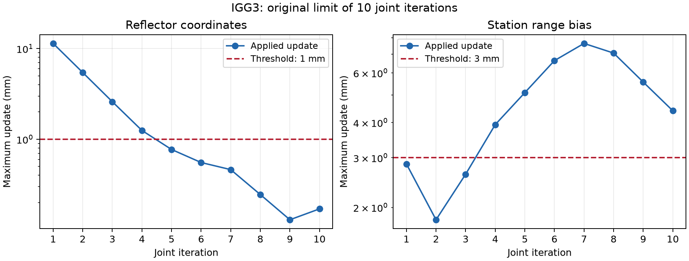

# 自转开发前的真实数据回归（2026-10-09）

2026-10-11 后续说明：本文及补核的逐值复跑结论对应 Chat review 修复前
的源码。随后修正了 Earth tide 的月球绝对加速度份额与纯轨道 ABM 导数
历史；尚未重跑修复后长弧。详见
[review 实证核对](DE440_CHAT_REVIEW_VERIFICATION.md)，历史归档保持原样。

## 验证范围与基线

被测科学代码提交为 `2c74e0f`，上一提交为 `e4f8caa`。首批共 13 个场景，
每个场景分别运行两个提交，输出隔离，输入和物理配置相同。
六种 O−C 场景另外运行结构精简前的 `c6cd6f8`，确认多轮精简是否累计改变测距。
测试期间未修改 LunarOps 的生产物理代码。
因 IGG3 原联合迭代上限不足，追加第 14 个场景：保持初值、筛选、权策略和
收敛阈值，只把联合迭代上限从 10 提高到 20，仍分别从原始初值运行两个提交。

配置及 21 个输入文件的 SHA-256 保存在
[`output/regression_20261009/manifest.json`](../output/regression_20261009/manifest.json)。
三个编译数值内核的哈希也已保存；三个提交的对应 pyx 源码一致，使用同一组已编译内核。
88 个历史对比文件的哈希也已保存。
Python 使用项目 `.venv`（3.14.6），MPI 使用 OpenMPI 4.0.3，
NumPy 2.5.2、SciPy 1.18.1；其他包版本见 manifest。BLAS/OpenMP 线程数固定为 1。

预测、O−C 和参数估计均提交 Slurm，**每个作业 1 节点、32 核心、32 MPI ranks**。
rank 0 调度，31 workers 计算；日志中的任务进度也记录了 ranks=32。
轨道是单进程积分，每个作业占 1 核心。

作业数组：

| 作业 | 内容 |
|---|---|
| `44961692_0–3` | DE430／DE440 十年积分，各运行上一提交与当前代码 |
| `44961693_0–21` | 11 个 MPI 场景，各运行上一提交与当前代码 |
| `44961719_0–5` | 六种 O−C 的精简前提交复核 |
| `44961725_4` | 重跑预测网格基线：原任务数值计算完成，但离线比较脚本把目录中站点／反射器目录文件误当成预测表；现已按 archive 类型选择文件 |
| `44961726_22–23` | IGG3 上限提高到 20 的补跑 |

## 月球轨道积分

采用既有 2026-10-05 回归的原配置：3650 天、5400 s 主步长、675 s 启动步长、
ABM 13 阶、2 次 corrector，内部 DOP853 启动，每条轨道 58401 个输出节点。
DE430 输出 3651 个日诊断，DE440 输出 58401 个诊断。

两条轨道及所有力项诊断与 `e4f8caa` **逐值完全一致**。
两条轨道与历史归档也逐值完全一致；历史诊断中的差异仅在约 10⁻²⁸ m/s² 的浮点末位。

相对各自参考星历的 RTN 位置差如下，单位 mm：

| 星历 | RMS R | RMS T | RMS N | 最大 R | 最大 T | 最大 N |
|---|---:|---:|---:|---:|---:|---:|
| DE430 | 3.424502 | 18.928592 | 0.239626 | 17.518164 | 51.866919 | 1.982425 |
| DE440 | 29.656615 | 64.785563 | 1.323613 | 77.428672 | 186.323757 | 3.446390 |

这验证了当前六状态受迫轨道模型的结果保持不变，不表示已经实现完整的平动／自转耦合星历。

2026-10-11 补核：本表 DE440 从 J2000 TDB（JD 2451545.0）起算。
自转开发后的当前源码原样复跑该配置，轨道及全部力项诊断仍与本轮归档
逐值完全一致。186.323757 mm 是沿轨分量最大值，对应位置差模长最大
186.510988 mm。保持步长、时长和力模型，仅改为 1969-06-28 TDB
（JD 2440400.5）起算，最大位置差模长为 478.752435 mm。
因此不能将后续 1969 年联合积分约 459 mm 的结果当作本场景精度退化；
不同时间段的残余模型／数值误差仍需分别排查。
完整对照见 [DE440 联合积分诊断](DE440_COUPLED_ROTATION_AUDIT.md)。

## LLR 观测预测

| 场景 | 原始采样数 | 当前对上一提交 | 当前对历史输出 |
|---|---:|---|---|
| 6 小时、5 s 网格 | 4321 | 完全一致 | 完全一致 |
| A15 五晚，2026-09-13 至 09-17 | 1800 | 完全一致 | 完全一致 |
| 31 晚，2026-08-25 至 09-24 | 22351 | 完全一致 | 距离、角度、时刻、可见性及窗口完全一致；两晚的反射器 ITRF z 坐标最大差 1.013279 μm |

逐字段检查站点和反射器坐标、上行几何距离、方位角、仰角、UTC／本地时刻、
observable 标记和窗口；合并预测表也参与比较。
旧预测／窗口 archive 的读取只存在于离线验证脚本，没有加入生产兼容代码。
历史坐标采用六位小数输出，因此仅历史 ITRF 坐标允许 2 μm 绝对差；
其他预测量以及两个提交之间的全部量仍要求完全一致。

注意：A15 配置文件名保留了 `202505`，实际配置中的日期是 2026 年 9 月，
本次按实际配置运行并比较对应历史文件。

## LLR 数据处理及 O−C

每个场景重新转换 `TOTALOBS6924.DAT` 的 35055 条法点，生成 EOP、站点／反射器
目录，并用 MPI 计算 O−C。六个场景的全部科学字段、收敛标记、状态和记录数，
与 `e4f8caa`、`c6cd6f8` 均逐值完全一致。

| 场景 | 光时收敛数 | 未收敛数 | 全部记录的单程 O−C RMS（m） |
|---|---:|---:|---:|
| INPOP21a＋经度天平动修正 | 35050 | 5 | 1.158196580 |
| INPOP21a | 35054 | 1 | 1.158100253 |
| EPM2021 | 35055 | 0 | 1.158010122 |
| DE440 | 35055 | 0 | 1.161262064 |
| DE440 alreadyScaled | 35054 | 1 | 1.162886284 |
| DE440 tdbCompatibleLunarSurface | 35053 | 2 | 1.166759252 |

上表 RMS 包含粗差及未收敛诊断行，不能与筛选、加权后的估计 WRMS 直接比较。
未收敛行保持显式标记；本次没有提高容差或把它们强行标成成功。

**六种 O−C 没有通过旧归档的严格历史复现。** 例如 2026-08-19 的 INPOP 修正归档，
仰角最大差 0.005653746°，RTT 最大差 4.796163×10⁻¹² s，单程 O−C 最大差
0.718927 mm；旧归档有 1 行未收敛，当前有 5 行，具体行身份也不同。

源码证据在 `7db4cb3`（2026-08-20）：仰角从“反射事件位置变换后减站点”
改成“上下行两端 BCRS 事件之差，在对应站点事件时刻进行向量变换”。
这会影响对流层延迟和临界光时迭代；之后 EOP 也改为原生归档输入。
补跑 `c6cd6f8` 后结果与当前完全一致，证明这些差异早于本轮结构精简。
旧表缺少新增的 `obs_time_local` 显示列，历史比较只排除该列及源文件路径，
其余差异保留为失败记录，没有扩大 O−C 容差来消除它们。
DE440 tdbCompatibleLunarSurface 的历史文件已使用修正模型，RTT、O−C 和状态
完全一致；其严格历史检查只因仰角约 1.35×10⁻¹³° 的末位差而失败。

## 反射器坐标＋测距偏差估计

两种权策略均使用 INPOP21a＋经度天平动修正、相同位移／延迟模型、
5 个反射器的 15 个 PA 坐标分量及 31 个站点／区间测距偏差。
按现有配置依次估反射器、估偏差、联合估计，最终参数数为 46。
IGG3 使用 k0=1.5、k1=6.0；直接剔除使用 k0=3.0。

原配置的最终统计：

| 权策略 | 反射器／偏差／联合迭代数 | 最终收敛 | 最终秩 | 加权 RMS（mm） |
|---|---|---|---|---:|
| IGG3，上限 10 | 7／7／10 | 否 | 46／46 | 13.886167 |
| 直接剔除 | 6／4／3 | 是 | 46／46 | 18.533644 |

两组估计的上述全部科学输出，与 `e4f8caa` 完全一致。
但原 IGG3 不能作为已收敛结果：终止原因是 `MAX_ITERATION_COUNT_REACHED`。
第 10 次 HALEAKALA 1990-02-06／1990-09-02 区间偏差的更新为 4.403716 mm，
超过 3 mm 阈值；最终剩余线性改正最大为 3.425248 mm。
反射器和单独偏差阶段已经收敛，联合估计仍需更多迭代。



图中是每步实际参数更新的最大幅度，不是参数误差或 formal σ。
坐标和偏差必须在同一次迭代同时满足各自阈值。

**IGG3 上限 20 的补跑在第 12 次联合迭代收敛，两个提交的科学结果完全一致。**
反射器／偏差／联合阶段分别为 7／7／12 次，均已收敛；最终正规方程满秩
46／46，活跃观测数 33387，WRMS 为 13.886301 mm，`sigma0_post=0.999988421`。
最终剩余线性改正最大为 1.656308 mm，保持原来的坐标 1 mm／偏差 3 mm 阈值。
分块最大剩余改正为坐标 0.064722 mm、偏差 1.656308 mm，均在阈值内。
补跑的前 10 次联合更新与原运行完全一致，证明增加预算没有改变此前的求解路径。
两组主计算分别耗时约 1663 s、1673 s，Slurm 任务均 `COMPLETED`、`ExitCode=0:0`。
示例配置的联合迭代上限已改为 20。原上限 10 的结果和失败标记继续保留，
验证脚本也明确固定该诊断场景为 10，避免修改示例后失去这项证据。

比较绝对参数及不确定度、协方差、正规方程 N／W／x0／lPl／观测数、
科学报告和最终后验残差。报告比较只去掉 fingerprint、运行时间和输出路径。
另验证解文件等于最终线性化状态 x0、不重复应用剩余改正，正规方程满秩，
协方差对称、`N C / sigma0² ≈ I`、不确定度符合 3σ 约定。

历史估计文件使用不同设置，不能当成相同配置的等价基线：
旧 MLRS1 粗差阈值为 1.5 m，当前为 1.0 m；旧直接剔除的偏差收敛阈值为
2 mm，当前为 3 mm，初始化及步骤安排也已有变化。
旧参数与当前参数的逐项差保存于 comparison.json 的 `historical_solution`，
该字段明确标记 `same_configuration=false`，没有宣称这些数值必须相等。

## 结果位置与复查方式

完整结果保存在 [`output/regression_20261009/`](../output/regression_20261009/)。
每个场景有独立配置、原始输出、`run.json` 和 `comparison.json`；
日志在 `logs/regression_*`。汇总是
[`summary.json`](../output/regression_20261009/summary.json)。

`passed` 包含严格历史复现和收敛检查，所以旧 O−C 的差异会让它为 false；
`current_regression_passed` 排除历史对比，但仍要求估计收敛，原 IGG3 上限 10
的场景不满足该条件。`source_equivalence_passed` 单独表示源码基线一致性与
代数检查，区别于估计是否收敛，不能混读。
后续加入自转时，应保存本轮 current 输出作为新的固定物理基线。
参数估计采用已收敛的 `estimate_igg3_extended/current/` 和
`estimate_direct/current/`，不要把上限 10 的 IGG3 输出当作收敛解。
自转开发约定见 [LUNAR_ROTATION_DEVELOPMENT.md](LUNAR_ROTATION_DEVELOPMENT.md)。

35 个 Slurm 子任务记录保存在
[`slurm_accounting.txt`](../output/regression_20261009/slurm_accounting.txt)。
除已说明并重跑的离线比较任务外，其余任务均正常结束。
附加检查：349 项 pytest 通过；新验证脚本 Ruff／mypy、三个 sbatch 语法及
修改后的参数估计配置校验均通过。
最终汇总为 `complete=true`、`source_equivalence_passed=true`；
其他总开关继续为 false，以保留原 IGG3 上限 10 未收敛以及旧 O−C 不严格复现的事实。

```bash
.venv/bin/python -m scripts.run_regression_suite prepare
sbatch run_regression_orbit.sbatch
sbatch run_regression_mpi.sbatch
sbatch run_regression_early.sbatch
# 等所有数组任务结束，再生成包含全部证据的汇总
.venv/bin/python -m scripts.run_regression_suite compare
```

这些脚本依赖本地既有历史轨道、预测、O−C 和参数归档，专门用于本轮回归。
